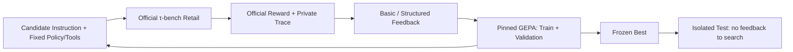

# Agent-Evolve

**最新 Goal：未完成。** 新语义反馈研究因 Qwen SDK `InternalServerError` 在第755次请求
停止。已完成20个Train基线、Basic的3个真实候选（第三批部分中断）；Structured搜索与
新M5 Test尚未运行。已知Usage估算¥3.3939484，另有未知请求保守预留¥9.796608，实际账单未知。
算法实现、误归因审查及未满足验收见 [本轮报告](docs/experiments/SEMANTIC_STUDY_REPORT.md)。
不能把下面的**历史小规模实验**当作新Goal或完整M4/M5的验收。

Evaluation-driven optimization and training experiments for LLM Agents.
当前项目：**GEPA × τ-bench 客服 Agent Prompt 优化与 Trace Feedback 对照**。

**实际结果**：已完成真实 Qwen Agent / Simulator / Reflection 链路及一次小规模
独立测试。GEPA-Basic、GEPA-Structured 各提出并真实评估 1 个新 Prompt，因评分
未严格超过 Seed 而拒绝；两组 Best 均保持 Seed。**没有证明性能提升或结构化反馈优势。**

| 独立 Retail Test | Baseline | GEPA-Basic Best | GEPA-Structured Best |
|---|---:|---:|---:|
| Task 5 | 1 | 0 (step limit) | 1 |
| Task 9 | 1 | 0 (step limit) | 0 (step limit) |
| Task 12 | 1 | 1 | 1 |
| 官方成功数 / 计划任务数 | 3/3 | 1/3 | 2/3 |
| 官方平均 Reward | 1.000 | 0.333 | 0.667 |

三列实际上使用**同一个 Prompt**，每任务每组仅 1 Trial。这些差异属于相同 Prompt
独立运行的变动，不能解释为优化效果；32 Steps 截断的原始官方 0 全部保留。
官方满分也不保证所有回复都遵守 Policy：人工审查发现认证遗漏与无依据时效承诺。
本轮 17 次任务评估 + 2 次 Reflection，共 **306 次请求、1,571,250 Tokens、估算 ¥1.293252**；
实际账单不可获得。仅覆盖无需 Judge 的 Retail 小子集，不是完整 Benchmark 或显著性结论。

[完整报告](docs/experiments/CORE_EXPERIMENT_REPORT.md) ·
[逐任务 JSON](docs/experiments/core-sprint-001/results.json) ·
[实际候选](docs/experiments/core-sprint-001/prompts.json) ·
[产物哈希](docs/experiments/core-sprint-001/manifest.json)

## Architecture / 数据流

新增语义引擎读取可观察对话/工具结果、固定Policy和工具定义，先校验引用，再对
候选判断做同模型二次质询，区分事实、假设、责任方和一般化建议。它尚不是可靠的
业务失败判定真值；人工审查发现引用有效仍可能误归因。正式Test前要求具体语义案例
审查记录及真实失败→Reflection→不同候选→官方评分链路；仅有true标志或绿CI不够。



GEPA core 与 τ-bench 使用独立锁定环境，串行子进程隔离业务状态；共享调用账本
覆盖 Agent、Simulator、Reflection。结构化诊断只描述可观察证据，不从 Reward=0
猜测原因，不把参考工具路径当成唯一正确答案。上游任务、Policy、Tools、Reward 未修改。

## Quick start / 离线启动

Python 3.12，uv 0.9.5。首次安装依赖需访问包仓库，以下检查无需模型密钥：

```powershell
uv sync --frozen --group dev
uv run --offline --frozen python -m pytest
uv run --offline --frozen ruff check .
uv run --offline --frozen ruff format --check .
uv run --offline --frozen python -m agent_evolve.baseline --config examples/m2/mock.json
```

没有 uv 时可用 `python -m venv .bootstrap`，再用
`.bootstrap/Scripts/python.exe -m pip install uv==0.9.5`；后续将 `uv` 替换为
`.bootstrap/Scripts/uv.exe`。同一 run_id 拒绝覆盖，已有示例运行需使用独立输出目录。
Mock 成绩仅验证工程接口。官方源码及隔离环境安装见 [M2](docs/M2_RUNBOOK.md)、
[M3](docs/M3_RUNBOOK.md)。

连续实验入口默认只读配置、零模型调用：

```powershell
environments/gepa/.venv/Scripts/python.exe -m agent_evolve.experiment --config examples/core_experiment.json
# 仅在新的明确预算授权下执行；本轮 ID 已使用，不可覆盖或自行重跑：
# ... -m agent_evolve.experiment --config <new-reviewed-config> --live
```

[真实运行与预算规则](docs/CORE_EXPERIMENT_RUNBOOK.md) 包含冻结配置、环境、停止条件
和私有产物结构。密钥及原始日志保持忽略，不进入 Git 或 CI。

## Roadmap / 实际进度

| Stage | Evidence |
|---|---|
| M1 Foundation | 工程规范、离线 CI、版本审计 |
| M2 Baseline & Trace | Qwen 真实单任务与官方 Reward |
| M3 GEPA Loop | 真实候选生成与评估完成；未产生更优 Best |
| M4 Trace Feedback | 离线规则 + 真实对照；未证明额外收益 |
| M5 Controlled Experiments | 9/9 Test、成本与失败分析、可审查交付；不合并、不发 Release |

长期可探索数据构建和 SFT/RL；当前不训练模型权重。下一步需先审查本轮的反馈信息
不足、Simulator/终止波动和官方评分覆盖边界，再决定新的实验。

## Documentation

- [Goals](GOALS.md), [Architecture](ARCHITECTURE.md), [Agent rules](AGENTS.md)
- [Project plan v0.2 (historical baseline)](docs/PROJECT_PLAN.md), [Protocol](docs/EXPERIMENT_PROTOCOL.md), [Decisions](docs/DECISIONS.md)
- [Core sprint validation](docs/validation/CORE_SPRINT_VALIDATION.md), [Experiment log](docs/experiments/EXPERIMENT_LOG.md)
- [Semantic Goal partial report](docs/experiments/SEMANTIC_STUDY_REPORT.md), [reviewed scalar records](docs/experiments/semantic-study-002/results.json), [Goal ExecPlan](.agent/plans/009-semantic-feedback-goal.md)
- [GEPA audit](docs/M3_GEPA_AUDIT.md), [τ-bench audit](docs/M2_UPSTREAM_AUDIT.md), [Feedback rules](docs/M4_FEEDBACK.md)
- [M1 validation](docs/validation/M1_VALIDATION.md), [M2-A](docs/validation/M2A_VALIDATION.md), [M3-A](docs/validation/M3A_VALIDATION.md), [M4-A](docs/validation/M4A_VALIDATION.md)
- [GitHub tracking](docs/GITHUB_TRACKING.md), [ExecPlan](.agent/plans/008-core-experiment-sprint.md)
